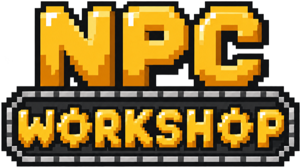
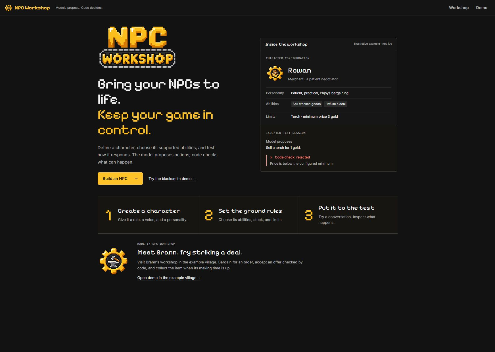
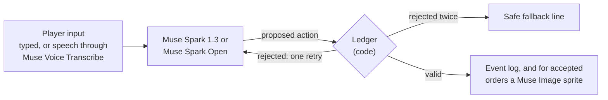

<p align="center">
  
</p>

**Build LLM-driven NPCs that can't break your game's rules.**

**[Watch the demo video](https://youtu.be/cr5qHfXWg8o)**

[](https://github.com/petar227p/npc-workshop/actions/workflows/ci.yml)


NPC Workshop is an authoring and testing tool for AI agents that play game characters. NPCs are agents built on Meta's Muse models: Muse Spark 1.3 and Muse Spark Open for dialogue and decisions, Muse Image for item art, and Muse Voice Transcribe for speech input. The model handles dialogue and proposes actions; a deterministic **ledger** decides what actually happens. Gold, stock, prices, timers and item stats are owned by code, never by the model.

Create a character, choose its abilities and limits, and test it in an isolated session. Then export it as a portable file and run it from your own game through an HTTP API. A playable demo village, featuring Brann the blacksmith, shows the full loop: negotiate an order, accept a checked offer, and collect the finished item.



## Contents

- [Key features](#key-features)
- [How it works](#how-it-works)
- [Quick start](#quick-start)
- [Create and test an NPC](#create-and-test-an-npc)
- [Use the NPCs from your own game](#use-the-npcs-from-your-own-game)
- [NPC definition format](#npc-definition-format)
- [Multi-model pipeline](#multi-model-pipeline)
- [Evaluation results](#evaluation-results)
- [Development](#development)
- [Project structure](#project-structure)
- [Status and limitations](#status-and-limitations)
- [Roadmap](#roadmap)
- [License and credits](#license-and-credits)

## Key features

- **Visual NPC editor.** Start from Merchant, Craftsperson, Villager, Bard / Town crier or Guard templates, a guided questionnaire, or a blank draft. Edit persona, model, permissions, catalogues, schedules, perception, appearance and fallbacks.
- **Rule-checked actions.** Every model proposal is schema-validated and checked by the ledger before it commits. Rejected proposals are logged, never applied.
- **Auditable by design.** World state is rebuilt by replaying the event log, so every session is reproducible.
- **Isolated testing.** Test sessions run a draft through the same checks as the live game, including a controlled rejection test that needs no model call.
- **Portable NPCs.** Export a `.npc.json` file and create worlds from it through the developer API, from any engine that can send HTTP.
- **Living world.** NPCs follow schedules, witness events by position, and pass on news. Knowledge inspection separates first-hand observations from second-hand reports.
- **Signals.** NPCs can ask the game to perform actions the ledger does not model (open a gate, raise an alarm), limited to a declared list. Your game's code decides whether they happen.
- **Generated item art and voice input.** Muse Image renders ordered items as palette-snapped pixel sprites; Muse Voice Transcribe turns spoken input into editable text.

## How it works

Dialogue alone cannot establish which trades a game can honor. NPC Workshop separates character decisions from authoritative state changes:

| The model | The code |
|---|---|
| Speaks in character, haggles, and chooses a verb | Owns gold, stock, prices, timers and delivery |
| Proposes `{ action, say, ...fields }` as JSON | Validates the proposal with Zod and one rule per verb |
| Gets one repair retry with the rejection reason | Logs every verdict; the event log is the source of truth |

A turn follows four steps:

1. **Propose.** The agent builds a strict JSON schema from the NPC's allowed verbs (`OFFER`, `REFUSE`, `SAY`, …) and calls the model.
2. **Validate.** `act(world, actor, rawJson)` parses the reply, checks the actor's role and applies the verb's rule against code-owned facts such as the price floor.
3. **Commit or reject.** Valid actions become events. Invalid ones are logged as `ACTION_REJECTED`; the model gets one retry, then the NPC falls back to a safe line.
4. **Deliver.** Timed work is delivered by the clock, with stats copied from the accepted offer. The model never writes them.



`npm run ledger-proof` shows this without a model or API key. It sends controlled proposals straight to the ledger (output shortened):

```text
PASS  1. Valid dagger offer (control)
      accepted
PASS  2. Underpriced offer (invalid)
      rejected: price 1 is below the minimum of 20 (materials 16 + 20% margin)
PASS  3. Impossible stats (invalid)
      rejected: damage 500 is above the cap of 10 for a dagger
PASS  4. Unauthorized early delivery (invalid)
      rejected: only the clock delivers items, once the work is done
PASS  5. The clock delivers at the due time (control)
      delivered once

5 of 5 cases pass.
```

## Quick start

### Prerequisites

- Node.js 24 or later (CI runs 26; the test suite also passes on 24)
- A Meta Model API key and/or a Baseten API key for live conversations (optional for exploring the editor)

### Install and run

```bash
npm install
cp .env.example .env
npm run dev
```

| URL | Description |
|---|---|
| [localhost:5174/#/](http://localhost:5174/#/) | Product home |
| [localhost:5174/#/workshop](http://localhost:5174/#/workshop) | Create, configure and test an NPC |
| [localhost:5174/#/village](http://localhost:5174/#/village) | Blacksmith demo village |
| `localhost:8787` | API server |

### Configuration

The server starts without keys: templates, the questionnaire and validation work without model calls. Keys are read only by the server.

| Variable | Required for |
|---|---|
| `MODEL_API_KEY` | Muse Spark conversations (Brann), item art and voice transcription. Enough on its own: every NPC works with just this key |
| `BASETEN_API_KEY` | Muse Spark Open conversations (villagers, gossip). Without it, those NPCs run on Muse Spark through the Meta Model API, and the server logs a line saying so |
| `SMITH_MODEL`, `VILLAGER_MODEL`, `IMAGE_MODEL`, `TRANSCRIBE_MODEL` | Overriding the default models |
| `PORT` | API port (default `8787`) |
| `REPLAY` | Replaying a recorded JSONL log instead of calling the APIs |

See [`.env.example`](.env.example) for the full list, including production settings.

## Create and test an NPC

1. **Start a draft.** In Workshop, choose a role template, **Help me choose**, **Copy an example**, **Blank NPC** or **Import NPC**. Named library entries are editable examples.
2. **Configure it.** Set the personality and abilities, then adjust catalogue limits, signals or automatic behavior. Drafts are saved in your browser and validated by the server.
3. **Test it.** Once the preview is valid, choose **Test your NPC** and try a normal conversation and a challenge. The controlled rejection test runs separately from the model.
4. **Download it.** **Download NPC** saves a portable `<id>.npc.json` (up to 2 MiB) containing the character settings, persona and reference pictures. Conversations, world progress and generated item art are not included.
5. **Connect it.** **Use in your game** shows a runnable backend command for the draft. In the interactive example, type `/verify` and copy the world ID and token into Workshop. The screen confirms the connection only after a successful external API reply for that exact configuration. Credentials are held in memory only.
6. **Import it later.** **Import NPC** restores a downloaded file after local and server validation. Failed or cancelled imports leave your current draft untouched.

Testing a draft does not publish it to the demo village. To add an NPC to the village and the startup registry during development, use **Save to files — development only** (never enabled in production) and restart the server.

## Use the NPCs from your own game

Your game creates a world from one or more NPCs, sends what the player says and does, and renders the events that come back. The server owns the world state; each world is authenticated by its own bearer token.

```bash
# Create a world from an NPC bundle and talk to it interactively
# (use your own download, or the sample in examples/npcs/)
npm run game-example -- --server http://localhost:8787 --bundle examples/npcs/portable_ada.npc.json --interactive
```

```bash
# Or call the API directly
curl -s -X POST localhost:8787/api/v1/worlds -H 'content-type: application/json' -d '{"npcs":["smith"]}'
# → { "world_id": "…", "token": "…", "npcs": [...], "state": {...} }
```

- [**Developer API reference**](docs/api.md): routes, response format, item mapping, signals and rate limits
- [**Backend example**](examples/game-backend/README.md): a runnable JavaScript integration
- [**Skyrim adapter**](examples/skyrim/README.md): an experimental Windows integration with Papyrus inventory transfers

## NPC definition format

In the development file workflow, an NPC is a definition in `npcs/<id>.json` plus a persona in `prompts/<id>.md`. Adding an NPC means adding these two files. An excerpt from [Brann's definition](npcs/smith.json):

```json
{
  "id": "smith",
  "name": "Brann",
  "verbs": ["SAY", "OFFER", "COUNTER_OFFER", "REFUSE", "START_WORK"],
  "model_verbs": ["SAY", "OFFER", "COUNTER_OFFER", "REFUSE"],
  "facts": ["clock", "purse", "stock", "catalogue", "price_floor", "open_offers"],
  "perception_radius": 4,
  "cue": "Reply to the customer's last words.",
  "fallbacks": {
    "rejected": "Hm. Let me think that through properly. Ask me again.",
    "unavailable": "The fire needs tending. Come back in a moment."
  }
}
```

| Field | Meaning |
|---|---|
| `verbs` | Actions the ledger allows this NPC to perform |
| `model_verbs` | The subset the model may choose; the rest (such as `START_WORK`) are issued only by code |
| `facts` | Named, code-owned world snapshots included in the prompt, so the model never has to remember values like the price floor |
| `perception_radius` | How far the NPC can witness events |
| `cue` | The instruction appended to each turn |
| `fallbacks` | Safe lines used when a proposal is rejected twice or the model is unavailable |
| `labels` | Optional display names for item IDs (see [item mapping](docs/api.md#mapping-your-games-items)) |

The full file also defines the catalogue, starting stock, model and world settings.

## Multi-model pipeline

One order can pass through three Meta model families: Muse Voice turns speech into text, Muse Spark decides what the NPC says and proposes, and Muse Image draws the item once the ledger has accepted the order. The ledger sits between the models, so a picture is only drawn from terms that passed its checks.

| Role | Model | Model ID | Provider |
|---|---|---|---|
| Brann the blacksmith (made-to-order negotiation) | Muse Spark 1.3 | `muse-spark-1.3` | Meta Model API |
| Mira, villagers, gossip and attackers | Muse Spark Open | `meta-models/muse-spark-open-1026` (configurable) | Baseten |
| Item pictures | Muse Image | `muse-image-1.0` | Meta Model API |
| Speech to text | Muse Voice Transcribe | `muse-voice-transcribe-1.0` | Meta Model API |

Muse Spark and Muse Spark Open always reason, so the clients send a low `reasoning_effort` with a generous token limit. Baseten does not enforce `json_schema` for Muse Spark Open, so every reply is validated with Zod and allowed one repair retry. Measured latency and cost are documented in [`docs/api-notes.md`](docs/api-notes.md).

## Evaluation results

| Check | Result | Measured |
|---|---|---|
| Ledger proof, controlled inputs and no model | 5 of 5 cases pass | Every CI run |
| Live attacks on six of the eight village NPCs | 106 attacks, 0 unauthorized state changes | Oct 29–30, 2026 |
| Independent evaluation, all eight NPCs | 27 of 27 fair customers served, 140 fresh attacks with 0 unauthorized state changes | Nov 4, 2026 |
| Muse Spark 1.3, Brann's quote turn, low effort | p50 3.7 s, p95 4.2 s | Oct 27, 2026, 5 calls |
| Muse Spark Open, the same turn, low effort | p50 2.4 s, p95 6.3 s | Oct 27, 2026, 5 calls |
| Muse Image, high reasoning strength | p50 17.2 s, p95 29.5 s | Oct 27, 2026, 5 calls |

In the live attacks the models never proposed an illegal action, so the ledger had nothing to refuse. The ledger's refusals are shown by the ledger proof, which uses controlled inputs. Details and limits are in [`eval/README.md`](eval/README.md).

## Development

| Command | Description |
|---|---|
| `npm run dev` | Start the web app and API server |
| `npm test` | Run the Vitest suite (engine, API, guided setup, UI helpers) |
| `npm run typecheck` | Typecheck shared, server, web, scripts, eval and examples |
| `npm run ledger-proof` | Feed controlled inputs (no model) and verify the ledger refuses invalid ones unchanged |
| `npm run exploit-suite` | Attack five village NPCs by default, or any you name with `--npcs`, using live models, and check the world after every attempt (~25 minutes) |
| `npm run independent-suite` | Check all eight NPCs with fair customers, fresh attacks and a words-against-the-record judge (~5 minutes, ~$2) |
| `npm run model-race` | Time the reachable models on evaluation jobs and check their answers (~1 minute) |
| `npm run smith-demo` | Scripted live session: order, accept, delivery, then an absurd request and an injection attempt |
| `npm run latency-test` | Time each model setup and check answers against the ledger (about 50 calls, ~6 minutes, ~$0.20) |
| `npm run game-example -- --help` | Connect a downloaded NPC from a JavaScript backend |

Every model call is recorded to `logs/<session>.jsonl` without keys. Replay a session offline with:

```bash
REPLAY=logs/<file> npm run smith-demo
```

## Project structure

```
shared/          Zod action schemas, event and view types (shared by server and web)
server/src/
  engine/        World state, events, verbs, validator and clock; pure and fully tested
  agents/        Generic NPC turn and flat-schema builder
  npcs/          NPC loading, fact blocks and conversation history
  models/        Meta and Baseten clients (chat, image, voice), recorder, replay and mock
  art/           Muse Image prompts, background removal and palette snapping
  routes/        Village API, developer API (/api/v1) and Workshop endpoints
web/src/         React product home, Workshop and demo; game/ contains the Phaser village
npcs/, prompts/  NPC definitions and personas
examples/        Backend and Skyrim integrations, plus a sample .npc.json bundle
scripts/         Dev runner, demos and ledger proof
eval/            Live-model latency test and exploit suite, with results
docs/            API reference, model notes and background research
```

## Status and limitations

NPC Workshop was built for the Meta Muse hackathon (November 2026) and is a working prototype.

- Abilities come from the built-in, code-owned verb library.
- Map-dependent settings (location, schedule, perception, sprites) use the bundled example village.
- Worlds are held in memory and lost on server restart. Editing a draft does not update running worlds.
- The Skyrim adapter is the only engine integration so far, and it is experimental. Durable storage and a global spend budget are not yet implemented.

## Roadmap

- Separate authoring and runtime concerns, and support game-specific world configuration beyond the bundled village.
- More engine adapters, and adding definitions to an existing world.
- A recorded comparison of a raw LLM against the ledger.
- A non-game NPC (a parts-supplier quote desk) on the same engine.
- Newcomer user studies, deployment and a global spend budget.

## License and credits

Released under the [MIT License](LICENSE). Copyright © 2026 Petar Penovic.

The MIT License covers this repository only. No model weights are included; Muse Spark Open is under the separate Muse Model License, a custom license that is not OSI-approved.

Pixel art in the demo village is from [Kenney](https://kenney.nl) (Tiny Town and Tiny Dungeon, CC0).
