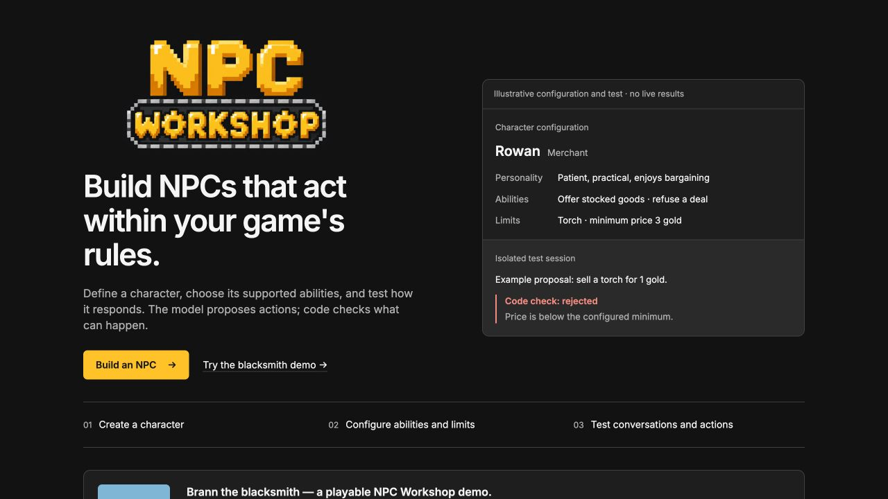

# NPC Workshop branding

Approved gold pixel logo with WORKSHOP inside the metallic conveyor and gear-shaped O letters. The home page uses the full transparent logo; workshop and demo headers use the N-in-a-gear icon beside the accessible product name.

Assets live in `web/public/brand/`: a 600 × 336 transparent logo, 512 × 512 transparent icon, 16/32/48 px favicon PNGs, and a 180 px Apple touch icon. `web/public/favicon.ico` contains all three favicon sizes. Artwork is local and ships with the Vite build.

The logo background was removed with imagegen from the approved corrected-W artwork. Both assets were cropped to their alpha bounds with padding; icons were resized from the approved gear-N artwork. Keep the shaded pixel style and proportional dimensions when making future versions.

Verified the home page and compact workshop header at desktop and 390 px mobile width. Build and repository type checks pass. The visual check used the web server alone; model/API behavior was outside this branding change.

